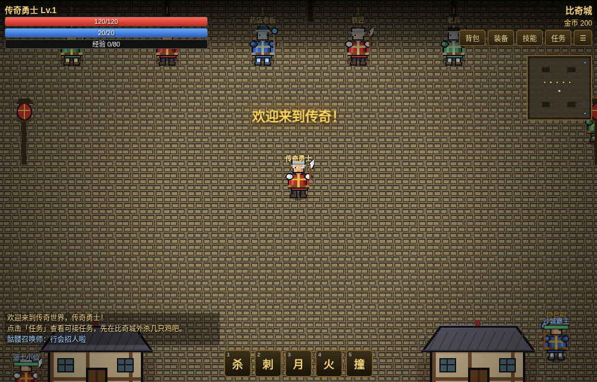
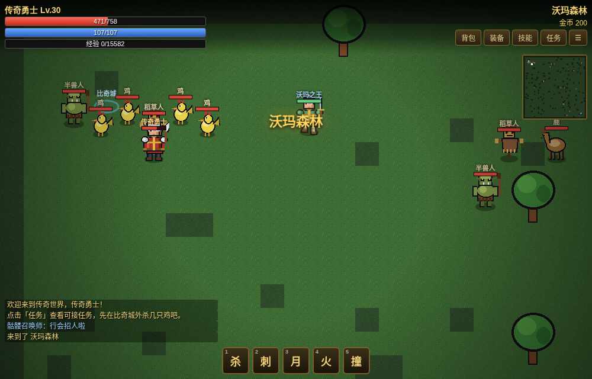
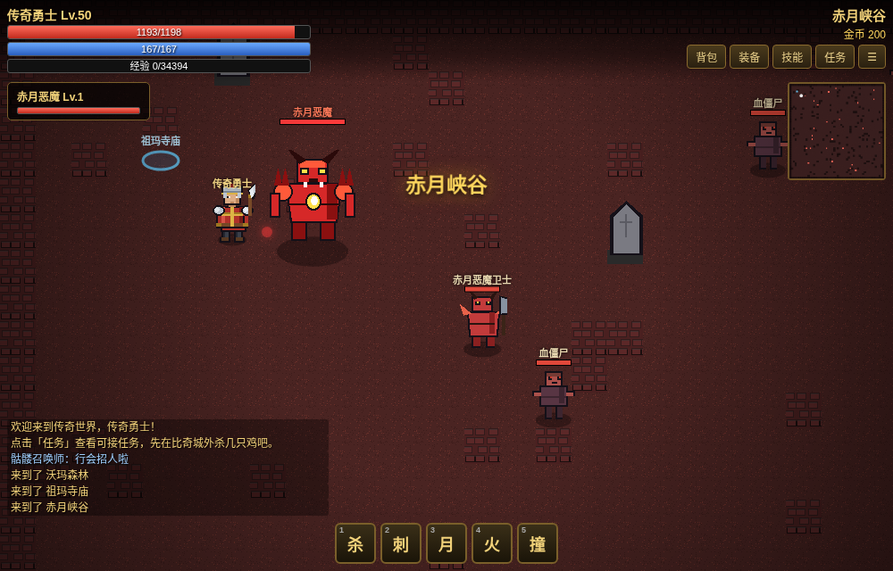

# 单机传奇 · 1.76 复古单机手游

> 一款向经典 1.76 版《热血传奇》致敬的**单机动作 RPG**。全世界只有你一个真实玩家，其余角色全部由 AI 机器人驱动。打怪升级、闯关爆宝、完成任务、强化转生，重现当年通宵沙巴克的热血记忆。



> 📥 **立即下载 APK**：[danji-chuanqi-v1.0.1.apk](https://github.com/donghuaigu123/danji-chuanqi/releases/download/v1.0.1/danji-chuanqi-v1.0.1.apk) · [Release 页面](https://github.com/donghuaigu123/danji-chuanqi/releases/tag/v1.0.1)

## 🎨 美术设计（v1.0.1 重制）

角色、怪物与场景全部弃用符号化画法，改为**手绘复古像素精灵**，高度还原 2000 年代初《热血传奇》《传奇世界》的 2.5D 观感：

- **角色**：战士/法师/道士均有盔甲、武器、五官细节，4 个朝向 × 2 帧行走动画
- **怪物**：鸡、鹿、稻草人、半兽人、蜈蚣、僵尸、祖玛卫士、白野猪、血僵尸、赤月恶魔各有独立像素造型
- **场景**：比奇城石板路 + 中式瓦房 + 灯笼柱，沃玛森林松柏，赤月峡谷墓碑与火把
- **素材全部由 `tools/gen_assets.py` 程序化绘制生成**，无外部版权图片

 

## ✨ 特色玩法

- **三职业体系**：战士（近身爆发）、法师（远程群攻）、道士（召唤+治疗+施毒），各有 6 个经典技能
- **18 个经典技能**：基本剑术、攻杀剑术、半月弯刀、烈火剑法、火球术、雷电术、冰咆哮、魔法盾、施毒术、灵魂火符、召唤骷髅、群体治愈术……
- **6 张大地图**：比奇城 → 沃玛森林 → 蜈蚣洞 → 祖玛寺庙 → 沙巴克 → 赤月峡谷，逐级解锁
- **丰富怪物**：鸡、鹿、半兽人、蜈蚣、僵尸、祖玛卫士、白野猪、赤月恶魔（BOSS）等
- **爆宝系统**：白/蓝/紫/橙/红 五档品质装备，井中月、裁决之杖、骨玉权杖、龙纹剑、嗜魂法杖、屠龙等经典神兵
- **任务系统**：8 条主线任务，击杀/收集/BOSS 多种类型，NPC 对话接取交付
- **装备强化 + 转生**：武器/衣服强化 +1~+10（每级 +25% 属性），50 级转生全属性大幅提升
- **BOSS 重生**：赤月恶魔被击败后 60 秒重生，可反复挑战
- **智能机器人**：地图上的其他"玩家"会自主打怪、游走、聊天，营造真实传奇氛围
- **移动端适配**：虚拟摇杆 + 技能按钮，随时随地掌上传奇

## 🎮 操作方式

| 操作 | 手机 | 电脑 |
|------|------|------|
| 移动 | 左侧摇杆 | WASD / 点击地面 |
| 攻击 | 攻击键（可长按连击） | 点击怪物 |
| 技能 | 技能按钮 / 快捷栏 | 数字键 1-8 |
| 拾取 | 拾取键 | Q / 空格 |
| 对话/传送 | 走到 NPC 点击 | 空格 / E |

## 📦 安装

下载 `releases` 中的 `单机传奇.apk`，在安卓手机上安装即可（需允许"安装未知来源应用"）。

> 最低安卓版本：Android 5.1（API 22）

## 🛠️ 从源码构建

```bash
npm install
npx cap sync android
cd android
./gradlew assembleDebug
# APK 输出: android/app/build/outputs/apk/debug/app-debug.apk
```

## 📁 项目结构

```
www/                    # Web 游戏源码（HTML5 Canvas）
├── index.html          # 界面结构
├── css/style.css       # 样式
└── js/
    ├── data.js         # 游戏数据（职业/技能/装备/怪物/地图/任务）
    ├── game.js         # 游戏引擎（渲染/战斗/AI/存档）
    └── main.js         # 入口与界面绑定
android/                # Capacitor Android 工程
```

## ⚖️ 声明

本项目为非商业、学习交流用途的同人单机作品，致敬经典 1.76 版传奇。所有素材均由代码程序化绘制，未使用原游戏版权资源。

---

Made with ❤️ for 传奇玩家
